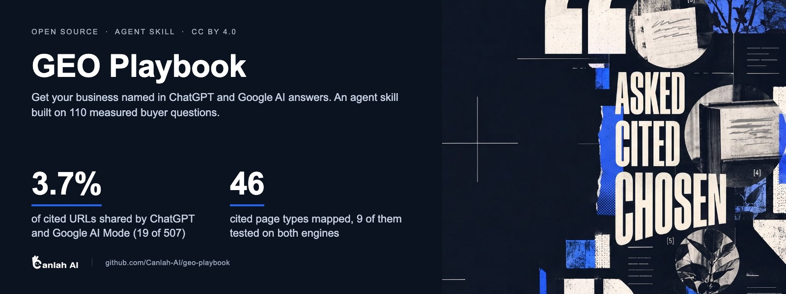
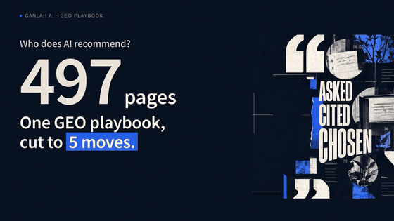

<p align="center">
  <a href="https://canlah.ai/playbook/?utm_source=github&utm_medium=community&utm_campaign=wk1019&utm_content=geo-playbook-readme">
    
  </a>
</p>

<h3 align="center">The agent skill for getting a business named in ChatGPT and Google AI answers.<br>Built on 110 measured buyer questions. Every rule shows its evidence.</h3>

<p align="center">
  <a href="LICENSE"></a>
  <a href="LICENSE-CODE"></a>
  <a href="https://doi.org/10.5281/zenodo.23005022"></a>
  <a href="https://github.com/Canlah-AI/ai-citations-sg-2026"></a>
  <a href="#30-second-start"></a>
  <a href="AGENTS.md"></a>
</p>

<p align="center">
  <a href="https://canlah.ai/playbook/?utm_source=github&utm_medium=community&utm_campaign=wk1019&utm_content=geo-playbook-readme"><b>Read the full playbook</b></a> ·
  <a href="https://github.com/Canlah-AI/ai-citations-sg-2026">Open dataset</a> ·
  <a href="#30-second-start">Install</a> ·
  <a href="#中文">中文</a>
</p>

<p align="center">
  <a href="assets/playbook-5-moves-44s.mp4">
    
  </a>
  <br><sub>▶ <a href="assets/playbook-5-moves-44s.mp4">Watch the 44-second film</a></sub>
</p>

---

We put the same 60 Singapore buyer questions to ChatGPT and Google AI Mode. Question by question, the two engines shared **19 of 507 cited URLs (3.7%)**. Two engines, two source lists. This skill has your agent check both and work through what's broken: crawler access, business identity, the pages AI quotes, and the third-party pages AI already reads.

## Contents

- [Why this exists](#why-this-exists)
- [30-second start](#30-second-start)
- [What your agent will do](#what-your-agent-will-do)
- [The method in five steps](#the-method-in-five-steps)
- [The full playbook](#the-full-playbook)
- [Evidence and data](#evidence-and-data)
- [How this differs from other GEO material](#how-this-differs-from-other-geo-material)
- [What's in this repository](#whats-in-this-repository)
- [Cite](#cite)
- [Credits, license, related](#credits-license-related)
- [中文](#中文)

## Why this exists

Most GEO advice is a checklist with no sample sizes. We measured first, on 110 buyer questions across five Singapore industries (dental and aesthetics, family law, tuition, B2B SaaS, e-commerce), and wrote the rules from what the engines actually cited:

| What we measured | Result |
|---|---|
| Cited URLs shared by ChatGPT and Google AI Mode, question by question | **3.7%** (19 of 507). In 36 of the 54 questions both engines answered with sources, they shared none |
| ChatGPT's cited URLs that sat in Google's organic top 10 for the same question | **7.2%** (22 of 307). Ranking on Google and getting cited by ChatGPT are different jobs |
| ChatGPT's cited URLs that repeat when the same question is asked twice, minutes apart | **23.9%** (53 of 222); 1 of 30 questions came back identical. One check is a sample, not a ranking |
| Where the copied sentence sits on cited family-law pages | The first sentence of a paragraph on **15 of 18** pages |
| Forum and social pages in ChatGPT's round-1 citations | **0 of 307**, against 30 of 219 for Google AI Mode |

Method: ChatGPT through the OpenAI API (`gpt-5.5` with web search, Singapore location); Google AI Mode through a third-party SERP API; both rounds run on 23 September 2026. API results, not the consumer app. Every number above can be recounted from the [open dataset](https://github.com/Canlah-AI/ai-citations-sg-2026).

## 30-second start

**Claude Code**, as a plugin:

```
/plugin marketplace add Canlah-AI/geo-playbook
/plugin install geo-playbook@canlah-ai
```

Then ask:

```
Audit https://your-site.com for visibility in ChatGPT and Google AI answers. Read-only: change nothing yet.
```

Other ways in:

| You use | Do this |
|---|---|
| Claude Code, as a personal skill | `git clone https://github.com/Canlah-AI/geo-playbook ~/.claude/skills/geo-playbook` (copying only `SKILL.md` and `references/` also works) |
| Codex, Cursor, OpenClaw or any agent that reads `AGENTS.md` | Copy [`AGENTS.md`](AGENTS.md) and `references/` into your project root, or add this repo as a submodule. Same instructions as `SKILL.md`, nothing Claude-specific |
| The skills CLI | `npx skills add Canlah-AI/geo-playbook` |

The skill loads on requests like "audit my site for ChatGPT visibility", "why does AI get our prices wrong", "write a price guide page AI will quote" or "we're a dental clinic, what can we publish?".

## What your agent will do

The agent edition runs the method as eight steps, read-only until a baseline is saved:

| Step | What happens |
|---|---|
| 0. Decide the side | Four questions place the business on the strictly regulated, lightly regulated or unregulated side; six switches add hard gates |
| 1. Door check | Snippet switches (`nosnippet`), robots.txt rules for retrieval crawlers, the WAF, and prices in the initial HTML (major AI crawlers do not run JavaScript, per Vercel and MERJ's crawl data) |
| 2. Identity | The same name, address, phone, registration numbers and prices everywhere |
| 3. Baseline | Freeze 30 real buyer questions for the quarter, ask them, save the answers |
| 4. Pick targets | Which questions are worth winning, and where each one should land |
| 5. Write pages by type | 46 cited page types with block order, the block AI copies most, and which engine cites it |
| 6. Off-site | Get correct facts onto the pages AI already reads: registers, associations, locators, bylined articles |
| 7. Monthly retest | Same questions, same engines, three numbers kept apart |

Ground rules the agent follows at every step: never promise rankings or timelines, label every claim (measured n/N, measured once, or not measured), and ask before touching the user's site or accounts. Full operating guide: [`SKILL.md`](SKILL.md).

## The method in five steps

1. **Measure first.** Write 30 questions real buyers ask (from their own words, ad keywords, real search queries; never AI-generated), ask them, save the answers, and measure how much results swing on their own. Freeze the questions for the quarter.
2. **Open the door.** Let AI crawlers read the page text: snippet switches, robots.txt retrieval crawlers, the WAF, and prices in the initial HTML.
3. **Be recognised.** The same name, address, phone, registration numbers and prices everywhere: a plain HTML facts page, person pages, five business profiles.
4. **Price page, then off-site.** The first page is an all-products price guide (English and Chinese). Then get correct facts onto the pages AI already cites: official registers, associations, manufacturer locators, bylined factual articles, correction letters.
5. **Check monthly.** Same questions, same engines, three numbers kept apart: times named, cited pages that mention you (X/20), facts AI gets wrong.

Steps 2 and 3 are pass or fail. If they fail, everything else is multiplied by zero.

## The full playbook

This repository is the condensed version for agents. The full text for people lives on canlah.ai, in English and Chinese:

| Edition | Web | PDF |
|---|---|---|
| General: 9 chapters + 4 appendices, all 46 cited page types | [English](https://canlah.ai/playbook/?utm_source=github&utm_medium=community&utm_campaign=wk1019&utm_content=geo-playbook-readme) · [中文](https://canlah.ai/zh/playbook/?utm_source=github&utm_medium=community&utm_campaign=wk1019&utm_content=geo-playbook-readme) | [EN, 497 pages](https://canlah.ai/playbook/files/geo-playbook-general-en.pdf?utm_source=github&utm_medium=community&utm_campaign=wk1019&utm_content=geo-playbook-readme) · [中文 362 页](https://canlah.ai/playbook/files/geo-playbook-general-zh.pdf?utm_source=github&utm_medium=community&utm_campaign=wk1019&utm_content=geo-playbook-readme) |
| Dental & Aesthetics | [English](https://canlah.ai/playbook/dental/?utm_source=github&utm_medium=community&utm_campaign=wk1019&utm_content=geo-playbook-readme) · [中文](https://canlah.ai/zh/playbook/dental/?utm_source=github&utm_medium=community&utm_campaign=wk1019&utm_content=geo-playbook-readme) | [EN, 172 pages](https://canlah.ai/playbook/files/geo-playbook-dental-en.pdf?utm_source=github&utm_medium=community&utm_campaign=wk1019&utm_content=geo-playbook-readme) · [中文 130 页](https://canlah.ai/playbook/files/geo-playbook-dental-zh.pdf?utm_source=github&utm_medium=community&utm_campaign=wk1019&utm_content=geo-playbook-readme) |
| Law Firms | [English](https://canlah.ai/playbook/law/?utm_source=github&utm_medium=community&utm_campaign=wk1019&utm_content=geo-playbook-readme) · [中文](https://canlah.ai/zh/playbook/law/?utm_source=github&utm_medium=community&utm_campaign=wk1019&utm_content=geo-playbook-readme) | [EN, 313 pages](https://canlah.ai/playbook/files/geo-playbook-law-en.pdf?utm_source=github&utm_medium=community&utm_campaign=wk1019&utm_content=geo-playbook-readme) · [中文 235 页](https://canlah.ai/playbook/files/geo-playbook-law-zh.pdf?utm_source=github&utm_medium=community&utm_campaign=wk1019&utm_content=geo-playbook-readme) |
| Quick guide | [On the landing page](https://canlah.ai/playbook/?utm_source=github&utm_medium=community&utm_campaign=wk1019&utm_content=geo-playbook-readme) | [EN, 12 pages](https://canlah.ai/playbook/files/geo-playbook-quick-guide-en.pdf?utm_source=github&utm_medium=community&utm_campaign=wk1019&utm_content=geo-playbook-readme) · [中文 12 页](https://canlah.ai/playbook/files/geo-playbook-quick-guide-zh.pdf?utm_source=github&utm_medium=community&utm_campaign=wk1019&utm_content=geo-playbook-readme) |

For agents: every chapter has a Markdown edition at the chapter URL plus `.md` (for example https://canlah.ai/playbook/start.md); all chapters are listed at https://canlah.ai/playbook/index.md. Every reference file in this repo links to the matching chapter section.

## Evidence and data

Both rounds ran in the early hours of 23 September 2026 (Singapore time), about 55 minutes apart:

- **Round 1, two engines.** 60 questions (6 in Chinese) on ChatGPT and Google AI Mode: **526 citations** (474 distinct URLs, 285 distinct hosts), and **92 cited pages taken apart** one by one.
- **Round 2, ChatGPT only.** 50 questions (5 in Chinese), a fixed set of nine question types per industry: **241 citations** (225 distinct URLs).

One citation means one distinct URL within one answer. The two rounds use different questions, so their counts are reported side by side, never added.

**The data is public.** Questions, every cited URL, ChatGPT answers and the page annotations are in [Canlah-AI/ai-citations-sg-2026](https://github.com/Canlah-AI/ai-citations-sg-2026) (CC BY 4.0, DOI [10.5281/zenodo.23005020](https://doi.org/10.5281/zenodo.23005020), also on [Hugging Face](https://huggingface.co/datasets/CanlahAI/ai-citations-sg-2026)). Scope: Singapore, five industries, API results, one ask per question in the official runs. What we have not done yet is listed in [`CREDITS.md`](CREDITS.md).

## How this differs from other GEO material

Full account, with the book section behind each point: [`CREDITS.md`](CREDITS.md).

- **Every rule states its evidence and sample size.** Rules are labelled "measured n/N", "measured, 1 case" or "not measured". Where measurement disagreed with common practice, we followed the measurement: the quoted sentence was almost always the first sentence of a paragraph (family law, 15 of 18 pages); of 75 quoted facts we could locate, about 55 sat in the top 30% of the page (positions estimated by eye); cited pages ran from 40 to about 9,000 words, so there is no word count to hit.
- **ChatGPT and Google AI Mode are measured, and written for, separately.** For Singapore dental questions, 76% of ChatGPT's citations (38 of 50) went to government and public-institution pages, while 75% of AI Mode's (39 of 52) went to clinics and other commercial sites. In e-commerce the two engines shared no cited URL at all. So every page carries an "own sentence" for ChatGPT and a "market sentence" for AI Mode, and retests record the engines separately.
- **46 page types, counted one by one.** 9 measured on both engines, 33 with ChatGPT evidence, 4 seen only in an outside teardown and marked unmeasured. Each type has a block order, the block AI most often copies, which engine mainly cites it, and what each regulatory side may do with it.
- **Regulated industries: three sides, six switches, three compliance labels.** Every compliance sentence carries one label: "explicit in the rule text", "conservative line, not explicit in the rule text" or "source text not obtained". A client's sign-off can relax only the first two kinds of stop, never an explicit ban. Every ban comes with what to write in its place.
- **Chinese pages and local anchoring.** Chinese pages are written from Chinese buyer questions, not translated, and must name the country in the H1, give an S$ amount with its tax basis in the first paragraph, and name a real MRT station or area.

## What's in this repository

```
SKILL.md                     Claude Code skill: the operating guide for agents
AGENTS.md                    the same guide for any agent that reads AGENTS.md
references/
  sides-and-compliance.md    three sides, six switches, three labels, sign-off rules
  page-types.md              46 page types: intent, engine, block order, what AI copies
  audit-checklist.md         five door gates, identity checks, per-page gates
  measurement.md             three numbers, noise band, baseline, monthly routine
  myths.md                   five things sold as GEO, and what to do instead
tools/                       build scripts for the book and site (MIT)
.claude-plugin/              plugin and marketplace manifests
CITATION.cff                 citation metadata (GitHub's "Cite this repository" button)
CREDITS.md                   what we borrowed, how we differ, what we have not done
LICENSE                      CC BY 4.0 (content)
LICENSE-CODE                 MIT (code in tools/)
```

## Cite

> Pang, H. (2026). *GEO Playbook v1.0*. Canlah AI. Zenodo. https://doi.org/10.5281/zenodo.23005022

```bibtex
@book{pang_2026_geo_playbook,
  author    = {Pang, Haoyang},
  title     = {GEO Playbook v1.0: A Measured Method for Getting Cited in ChatGPT and Google AI Mode Answers (Singapore)},
  year      = {2026},
  version   = {1.0},
  publisher = {Canlah AI},
  doi       = {10.5281/zenodo.23005022},
  url       = {https://doi.org/10.5281/zenodo.23005022}
}
```

Attribution for reuse under CC BY 4.0: *GEO Playbook by Canlah AI, https://canlah.ai/zh/playbook/*

**Star this repo** if it saves your team a round of guesswork. Stars are how other marketers and agent builders find a GEO method that shows its sample sizes.

**Coming next from Canlah AI:** 《AI 数字营销实战》, a 1,100+ page hands-on Chinese textbook on AI marketing: 21 chapters, 63 exercises with practice data, and 160+ real AI runs written into the worked examples. Follow [Canlah-AI](https://github.com/Canlah-AI) to catch the release.

## Credits, license, related

**Credits.** This playbook was not written from scratch. We borrowed template structures, sentence patterns and rule names from Aaron He's open-source [aaron-marketing-skills](https://github.com/aaron-he-zhu/aaron-marketing-skills) (Apache-2.0), rewritten rather than copied; five page types come from a teardown of a GEO agency's public blog (not named; four are the unmeasured tier C types, the fifth was merged into a measured type); and the rules rest on public studies, official crawler documentation and regulations listed row by row. None of the people or organisations credited took part in or reviewed this work. Full list: [`CREDITS.md`](CREDITS.md). Wrong attribution? Please open an issue.

**License.** Content (all Markdown in this repository and the playbook on canlah.ai): [CC BY 4.0](LICENSE). Code in `tools/`: [MIT](LICENSE-CODE), © 2026 Canlah AI.

**Related.**

- [Canlah-AI/ai-citations-sg-2026](https://github.com/Canlah-AI/ai-citations-sg-2026): the measurement data behind this playbook (CC BY 4.0, DOI 10.5281/zenodo.23005020, [Hugging Face](https://huggingface.co/datasets/CanlahAI/ai-citations-sg-2026), [canlah.ai](https://canlah.ai/data/ai-citations-sg-2026/?utm_source=github&utm_medium=community&utm_campaign=wk1019&utm_content=geo-playbook-readme)).
- [Canlah-AI/seven-engines-geo-forensics](https://github.com/Canlah-AI/seven-engines-geo-forensics): one commercial question put to seven search and AI-answer engines in one night, with raw data, frozen classification code and verified mechanism claims (CC BY 4.0, DOI 10.5281/zenodo.22225223). It asks whether engines cite the same sources; this playbook asks what a cited page looks like and how to write one.
- [Canlah-AI/agent-readiness-2026](https://github.com/Canlah-AI/agent-readiness-2026): whether 50 cross-border DTC storefronts expose what an AI shopping agent looks for (CC BY 4.0, DOI 10.5281/zenodo.22103177).
- [*Marketing in the Agent Era*](https://canlah.ai/whitepaper/?utm_source=github&utm_medium=community&utm_campaign=wk1019&utm_content=geo-playbook-readme): our whitepaper. We traced 60 candidate claims to their primary sources; 20 passed unchanged. Full text free on the web.
- [aaron-he-zhu/aaron-marketing-skills](https://github.com/aaron-he-zhu/aaron-marketing-skills): Aaron He's open-source marketing skills, a source of several templates we adapted.

Questions or help with a first round: admin@canlah.ai

---

## 中文

**一套有实测依据的 GEO 方法，打包成 AI 助手能照着执行的 skill：让 ChatGPT 和 Google AI 在回答买家问题时更可能点到你的名字。不承诺排名。**

我们把同一批 60 个新加坡买家问句分别问了 ChatGPT 和 Google AI 模式，逐句比，两边只共用了 507 个被引网址里的 19 个（3.7%）。两个 AI，两份来源清单，两边都要查。这个 skill 让你的 AI 助手按八步走：先定监管侧别，再查爬虫能不能进门、机器认不认得出你是哪一家，冻结 30 个买家问句存下基线，然后按 46 种被引页型写页、上站外，每月同口径复测。

**30 秒上手（Claude Code）**

```
/plugin marketplace add Canlah-AI/geo-playbook
/plugin install geo-playbook@canlah-ai
```

装好后直接说：「帮我体检 https://你的网站 在 ChatGPT 和 Google AI 里的可见度，只读，先别改任何东西」。用 Codex、Cursor、OpenClaw 的，把 [`AGENTS.md`](AGENTS.md) 和 `references/` 复制到项目根目录即可。

**完整版在官网**：[中文完整版](https://canlah.ai/zh/playbook/?utm_source=github&utm_medium=community&utm_campaign=wk1019&utm_content=geo-playbook-readme)（通用版 9 章正文 + 4 个附录，PDF 362 页；另有牙科医美版 130 页、律所版 235 页、12 页轻量版）。测法：ChatGPT 走 OpenAI 接口（gpt-5.5 开网页搜索、定位新加坡），Google AI 模式走第三方 SERP 接口，2026 年 9 月 23 日跑完两轮；数据全部公开在 [ai-citations-sg-2026](https://github.com/Canlah-AI/ai-citations-sg-2026)。

**下一本：**《AI 数字营销实战》，1,100 多页中文实战教材，21 章、63 道练习，例题用的是 160 多份 AI 真实输出。关注 [Canlah-AI](https://github.com/Canlah-AI)，上线第一时间看到。

觉得有用，点个 Star，让更多做营销和做 AI 助手的人找到它。
